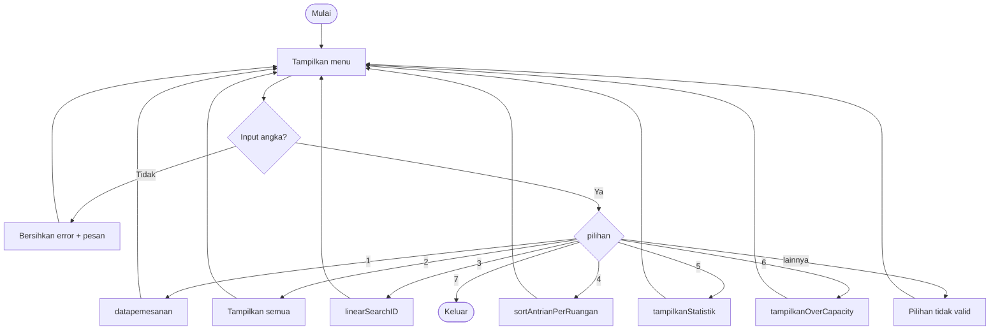
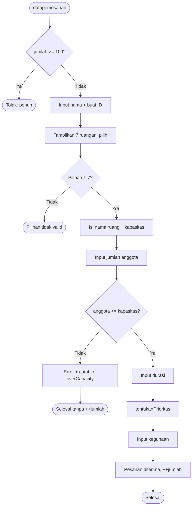

# Catatan Presentasi — Smart Campus Booking System UGM

Catatan ini untuk membantu memahami **alur dan cara kerja** `main.cpp` secara detail, sekaligus bahan latihan presentasi dan antisipasi pertanyaan.

---

## 1. Ringkasan Proyek (versi 30 detik)

> "Program ini adalah sistem pemesanan ruangan kampus berbasis console C++. Pengguna bisa memesan salah satu dari 7 ruangan. Sistem otomatis mengecek kapasitas, menentukan prioritas berdasarkan durasi, dan mencatat pemesanan yang melebihi kapasitas ke log terpisah. Pemesanan bisa diurutkan menjadi antrian per ruangan, dicari berdasarkan ID, dan dianalisis statistik durasinya."

**Fitur (menu):**

1. Tambah pemesanan
2. Tampilkan semua pemesanan
3. Cari pemesanan (linear search)
4. Urutkan antrian per ruangan (bubble sort)
5. Statistik & total durasi (rekursif)
6. Tampilkan data over capacity
7. Keluar

---

## 2. Konsep Pemrograman yang Dipakai

| Konsep | Dipakai di mana | Kenapa penting |
|---|---|---|
| `struct` | `Pemesanan` | Menggabungkan 10 data satu pemesanan jadi satu tipe data |
| Array of struct | `pemesanan[100]`, `overCapacity[100]` | Menyimpan banyak pemesanan |
| Pass by reference (`int&`) | `jumlah`, `jumlahOver` di `datapemesanan` | Fungsi bisa mengubah counter milik `main` |
| Array sebagai parameter | semua fungsi | Array dikirim sebagai pointer, jadi perubahan (mis. sorting) langsung mengubah array asli |
| `const` | `const Pemesanan[]`, `const string&` | Menandai data hanya dibaca, tidak diubah (lebih aman) |
| Percabangan (`if/else`, `switch`) | prioritas, menu | Logika keputusan |
| Perulangan (`for`, `do-while`) | menu utama, tampil data, sorting | Pengulangan |
| **Rekursi** | `hitungTotalDurasi` | Menjumlah durasi dengan memanggil diri sendiri |
| **Bubble Sort** | `sortAntrianPerRuangan` | Mengurutkan dengan kriteria bertingkat |
| **Linear Search** | `linearSearchID` | Mencari data tanpa perlu data terurut |
| `stringstream`, `setw`, `setfill` | `buatIDPemesanan` | Format ID jadi 5 digit (`00001`) |
| `cin.ignore`, `cin.clear` | input handling | Membersihkan buffer dan error input |
| Operator ternary `? :` | menu 2 | `if-else` satu baris untuk teks status kapasitas |

---

## 3. Struktur Data

```cpp
struct Pemesanan {
    string namaPemesan;
    string ID;              // "00001" atau "OV-00001"
    int    IDruang;         // 1..7  -> dipakai untuk sorting
    string namaruangan;
    int    kapasitasruangan;
    int    jumlahAnggota;
    int    durasi;          // menit
    string prioritas;       // "Rendah" / "Sedang" / "Tinggi" / "-"
    string kegunaan;
    bool   statuskapasitas; // true jika jumlahAnggota <= kapasitas
};
```

Dua array dipakai di `main`:

- `pemesanan[100]` → pemesanan yang **diterima**
- `overCapacity[100]` → **log** percobaan yang ditolak karena melebihi kapasitas

Counter-nya: `jumlahPemesanan` dan `jumlahOver`.

---

## 4. Alur Program

### 4.1 Flowchart menu utama



### 4.2 Flowchart tambah pemesanan (menu 1)



---

## 5. Penjelasan Detail Per Bagian

### 5.1 `buatIDPemesanan(int jumlahData)`

```cpp
formatID << setw(5) << setfill('0') << jumlahData + 1;
```

- `jumlahData + 1` dievaluasi lebih dulu karena `+` lebih tinggi prioritasnya daripada `<<`.
- `setw(5)` = lebar 5 karakter, `setfill('0')` = sisanya diisi `0` → `1` jadi `00001`.
- **ID dibuat dari jumlah pemesanan yang sudah diterima**, jadi berurutan dan unik selama tidak ada penghapusan data.
- Karena ID berformat tetap (5 digit), membandingkan ID sebagai string (`"00002" > "00001"`) memberi urutan yang sama dengan membandingkan angka. Ini dimanfaatkan saat sorting.

### 5.2 `tentukanPrioritas` dan `skorPrioritas`

- Prioritas ditentukan **hanya dari durasi** (asumsi desain: pemesanan lebih lama = lebih prioritas).
- `skorPrioritas` mengubah teks jadi angka karena string tidak bisa dibandingkan "lebih tinggi/lebih rendah" secara bermakna (urutan alfabet "Rendah" < "Sedang" < "Tinggi" kebetulan sama, tapi arahnya kebalik dari yang dibutuhkan, dan tidak eksplisit).

### 5.3 `datapemesanan` (fungsi paling panjang)

**Urutan langkah:** cek penuh → nama → ID → pilih ruangan → jumlah anggota → cek kapasitas → (durasi → prioritas → kegunaan) → simpan.

Poin penting:

1. **`cin.ignore(...)` sebelum `getline`.** Setelah `cin >> pilihan` di menu, karakter Enter (`\n`) masih tersisa di buffer. Kalau langsung `getline`, ia membaca baris kosong. `cin.ignore` membuang sisa itu.
2. **`cin.ignore` setelah `cin >> jumlahAnggota` dan `cin >> durasi`** alasannya sama, supaya `getline` berikutnya (kegunaan) tidak terlewat.
3. **Data ditulis ke `pemesanan[jumlah]` dulu, baru `jumlah` dinaikkan di akhir.** Jika pemesanan batal/ditolak di tengah jalan, `jumlah` tidak naik sehingga slot itu otomatis ditimpa pemesanan berikutnya. Ini membuat data setengah jadi tidak pernah "resmi" tersimpan.
4. **Validasi kapasitas:** `statuskapasitas = jumlahAnggota <= kapasitasruangan`.
5. **Penanganan over capacity:**
   - `overCapacity[jumlahOver] = pemesanan[jumlah];` menyalin seluruh struct.
   - ID diganti menjadi `"OV-" + buatIDPemesanan(jumlahOver)` agar beda dari ID pemesanan sah.
   - `durasi = 0`, `prioritas = "-"`, `kegunaan = "Ditolak (Over Capacity)"` karena data itu memang tidak diproses lebih lanjut.
   - Pesan error memakai `cerr` (stream error), info biasa memakai `cout`.
6. **Parameter `int& jumlah` dan `int& jumlahOver`** memakai reference supaya perubahan terlihat di `main`.

### 5.4 `sortAntrianPerRuangan` (Bubble Sort bertingkat)

Perbandingan dua elemen bersebelahan `[j]` dan `[j+1]`:

| Tingkat | Kondisi | Tukar jika | Arti |
|---|---|---|---|
| 1 | `IDruang` berbeda | `IDruang[j] > IDruang[j+1]` | Kelompokkan per ruangan, urut nomor ruangan |
| 2 | `IDruang` sama, skor berbeda | `skorA < skorB` | Prioritas Tinggi didahulukan |
| 3 | `IDruang` & skor sama | `ID[j] > ID[j+1]` | Yang mendaftar lebih dulu didahulukan (FIFO) |

- Loop luar `i` = jumlah putaran, loop dalam `j` berhenti di `jumlah - i - 1` karena elemen terbesar sudah "mengapung" ke ujung setelah tiap putaran.
- Penukaran memakai variabel `temp` bertipe `Pemesanan` (seluruh struct ditukar, bukan satu-satu field).
- **Sorting mengubah array asli** (in-place). Akibatnya urutan di Menu 2 dan *indeks* di hasil Menu 3 ikut berubah setelah Menu 4 dijalankan (ID tetap sama).
- Setelah sorting, fungsi memanggil `tampilkanAntrianPerRuangan`.

### 5.5 `tampilkanAntrianPerRuangan`

- Memakai variabel `ruangAktif` (awal `-1`) untuk mendeteksi pergantian ruangan.
- Saat `IDruang` berbeda dari `ruangAktif`: cetak header ruangan baru dan reset `noAntrian = 1`.
- **Fungsi ini mengandalkan data sudah terurut per ruangan.** Karena itu hanya dipanggil dari fungsi sorting. Jika dipanggil pada data acak, header ruangan yang sama bisa tercetak berulang.

### 5.6 `linearSearchID`

- Loop dari indeks 0, bandingkan `pemesanan[i].ID == targetID`.
- Ketemu → tampilkan data + indeks lalu `return` (berhenti di kecocokan pertama).
- Tidak ketemu setelah loop → "Data tidak ditemukan!".
- ID harus diketik lengkap 5 digit (`00003`, bukan `3`).
- Yang dicari hanya array `pemesanan` (data diterima), **bukan** log `OV-`.

### 5.7 Fungsi statistik

**`hitungTotalDurasi` (rekursif):**

```
total(n) = durasi[n-1] + total(n-1)
total(0) = 0              <- base case
```

Contoh n = 3, durasi = [30, 90, 120]:

```
total(3) = 120 + total(2)
         = 120 + (90 + total(1))
         = 120 + (90 + (30 + total(0)))
         = 120 + 90 + 30 + 0 = 240
```

- **`hitungRataRataDurasi`** = `(double)total / n`. Cast ke `double` wajib agar tidak terjadi pembagian integer (mis. `7/2` jadi `3`, bukan `3.5`).
- **`hitungDurasiTertinggi/Terendah`** memakai pola "anggap elemen pertama sebagai kandidat, lalu bandingkan sisanya".
- Semua fungsi punya guard `jumlah <= 0` agar tidak mengakses array kosong.

### 5.8 `main`

- `do { ... } while (pilihan != 7);` → menu pasti tampil minimal satu kali.
- `if (!(cin >> pilihan))` menangkap input non-angka. `cin.clear()` mereset status error, `cin.ignore(...)` membuang sisa input yang salah. Tanpa ini program akan loop tanpa henti.
- `continue` di dalam `do-while` melompat ke pengecekan kondisi `pilihan != 7`; karena `pilihan` bernilai 0 setelah gagal baca, loop lanjut.
- Case 3 memakai kurung kurawal `{ }` karena mendeklarasikan variabel lokal `targetID` di dalam `case`.

---

## 6. Dry Run (Simulasi Manual)

**Skenario:** 5 pemesanan sah, lalu Menu 4 dan Menu 5.

| Index | ID | Pemesan | IDruang | Durasi | Prioritas |
|---|---|---|---|---|---|
| 0 | 00001 | Andi | 3 | 30 | Sedang |
| 1 | 00002 | Budi | 1 | 90 | Tinggi |
| 2 | 00003 | Citra | 3 | 120 | Tinggi |
| 3 | 00004 | Dewi | 1 | 10 | Rendah |
| 4 | 00005 | Eko | 1 | 45 | Sedang |

**Hasil setelah sorting:**

| Index | ID | Pemesan | Ruang | Prioritas |
|---|---|---|---|---|
| 0 | 00002 | Budi | 1 | Tinggi |
| 1 | 00005 | Eko | 1 | Sedang |
| 2 | 00004 | Dewi | 1 | Rendah |
| 3 | 00003 | Citra | 3 | Tinggi |
| 4 | 00001 | Andi | 3 | Sedang |

**Statistik:** total = 30+90+120+10+45 = **295**, rata-rata = 295/5 = **59**, tertinggi = **120**, terendah = **10**.

**Skenario over capacity:** Ruang Diskusi 1 (kapasitas 10), 15 anggota → ditolak → `jumlah` tidak berubah, `jumlahOver` jadi 1, log `OV-00001`, kelebihan 5 orang.

---

## 7. Kompleksitas

| Operasi | Waktu | Catatan |
|---|---|---|
| Tambah pemesanan | O(1) | Tulis ke slot terakhir |
| Linear search | O(n) | Terburuk: cek semua data |
| Bubble sort | O(n²) | Dua loop bersarang; ruang tambahan O(1) |
| Total durasi (rekursif) | O(n) | Kedalaman rekursi n → memori stack O(n) |
| Rata-rata | O(n) | Memanggil total lagi |
| Maks / Min | O(n) | Satu kali loop |

---

## 8. Hal Menarik / Mudah Terlewat

1. **Jumlah yang ditolak tidak memakai nomor ID.** `jumlah` tidak naik saat ditolak, jadi ID pemesanan sah berikutnya tidak "loncat".
2. **Menu 2 selalu menampilkan "mencukupi".** Hanya pemesanan yang lolos cek kapasitas yang masuk array `pemesanan`, jadi field `statuskapasitas` di sana selalu `true`.
3. **Label Menu 5 menyebut "Rekursif", padahal hanya total durasi yang rekursif.** Maks dan min pakai loop biasa. Kalau ditanya, jawab dengan jujur: rekursi dipakai pada penjumlahan total, dan rata-rata memanfaatkannya.
4. **Urutan output `cerr` vs `cout`** bisa tampil tidak persis berurutan di beberapa terminal karena keduanya stream berbeda.
5. **Data hilang saat program ditutup** karena hanya disimpan di array (memori).

---

## 9. Keterbatasan & Ide Pengembangan

Bagian ini berguna saat sesi tanya jawab: lebih baik menyebutkan sendiri keterbatasannya daripada ditemukan penguji.

| Keterbatasan | Ide perbaikan |
|---|---|
| `jumlahAnggota` dan `durasi` tidak divalidasi (bisa negatif/nol; huruf akan merusak status `cin`) | Fungsi validasi input berulang sampai valid (`while (!(cin >> x) \|\| x <= 0)`) |
| Tidak ada tanggal/jam, jadi "antrian" hanya urutan prioritas, bukan jadwal bentrok | Tambah field tanggal & jam mulai, cek bentrok waktu per ruangan |
| Data tidak tersimpan permanen | Simpan/baca dari file (`fstream`) |
| Tidak ada edit/batalkan pemesanan | Tambah menu hapus/ubah |
| Ruangan di-hardcode dan array ukuran tetap (100) | Pakai `vector` dan data ruangan dari file |
| Bubble sort O(n²) | `std::sort` dengan comparator, atau merge sort |
| Pencarian hanya berdasarkan ID & tidak mencakup log OV | Cari berdasarkan nama/ruangan; cakup `overCapacity` |
| Log over capacity diam-diam tidak tercatat jika sudah penuh (100) | Beri pesan jelas |
| Prioritas hanya dari durasi | Tambah faktor lain (jenis kegiatan, status pemesan) |

---

## 10. Antisipasi Pertanyaan

**Q: Kenapa pakai `struct`, bukan beberapa array terpisah?**
A: Satu pemesanan punya banyak atribut yang saling terkait. Dengan `struct` data satu pemesanan selalu bergerak bersama, dan saat sorting cukup menukar satu elemen, bukan 10 array sekaligus (yang rawan tidak sinkron).

**Q: Kenapa pakai bubble sort?**
A: Mudah dipahami dan diimplementasikan untuk data kecil (maks 100). Kekurangannya O(n²); untuk data besar lebih baik `std::sort` atau merge sort.

**Q: Kenapa harus pakai `skorPrioritas`?**
A: Prioritas disimpan sebagai teks, sedangkan sorting butuh nilai yang bisa dibandingkan secara numerik. Skor menerjemahkan teks ke angka 1–3.

**Q: Kenapa `int&` pada `jumlah`?**
A: Agar perubahan nilai di dalam fungsi tersimpan ke variabel asli di `main`. Tanpa `&`, yang berubah hanya salinannya.

**Q: Apa yang terjadi kalau user ketik huruf di menu?**
A: `cin >> pilihan` gagal, kita `clear()` status error dan `ignore()` sisa input, lalu menu ditampilkan lagi. Tapi untuk input jumlah anggota dan durasi, validasi seperti ini belum ada (lihat keterbatasan).

**Q: Apa base case rekursi di program ini?**
A: `jumlahPemesanan <= 0` → return 0. Tanpa base case, rekursi tak akan berhenti (stack overflow).

**Q: Kenapa harus `(double)` di rata-rata?**
A: Pembagian dua `int` menghasilkan `int` (desimal terpotong). Cast ke `double` menjaga hasil desimal.

**Q: Apa beda linear search dan binary search? Kenapa tidak pakai binary?**
A: Binary search butuh data terurut berdasarkan kunci pencarian dan lebih cepat (O(log n)). Array kita diurutkan berdasarkan ruangan/prioritas, bukan ID, jadi linear search lebih tepat dan sederhana.

**Q: Kenapa ID over capacity pakai awalan `OV-`?**
A: Supaya jelas terpisah dari ID pemesanan sah dan tidak membingungkan di laporan.

---

## 11. Saran Urutan Demo (±5 menit)

1. Jalankan program, tunjukkan menu.
2. **Menu 1:** tambah 4–5 pemesanan dengan ruangan & durasi bervariasi (pakai data uji di bagian 6).
3. **Menu 1:** coba pemesanan **over capacity** (mis. 15 orang di Ruang Diskusi 1) → tunjukkan error.
4. **Menu 6:** tunjukkan log over capacity.
5. **Menu 2:** tampilkan semua pemesanan (urutan masih sesuai input).
6. **Menu 4:** urutkan → jelaskan 3 tingkat perbandingan sambil menunjuk hasilnya.
7. **Menu 3:** cari ID (`00003`) dan satu ID yang tidak ada.
8. **Menu 5:** tunjukkan statistik dan jelaskan rekursi total durasi.
9. **Menu 7:** keluar.

**Kerangka bicara:** masalah → solusi (fitur) → konsep yang dipakai → demo → keterbatasan & pengembangan.
